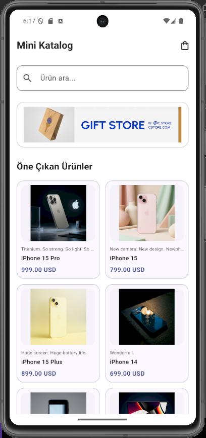
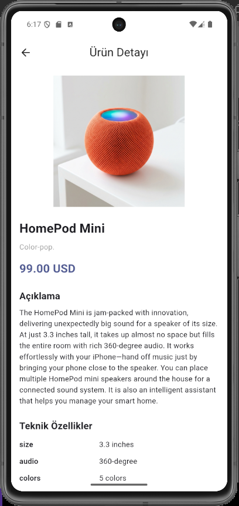
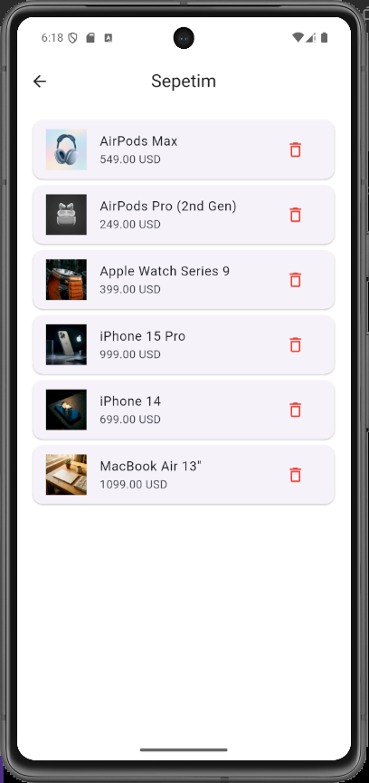
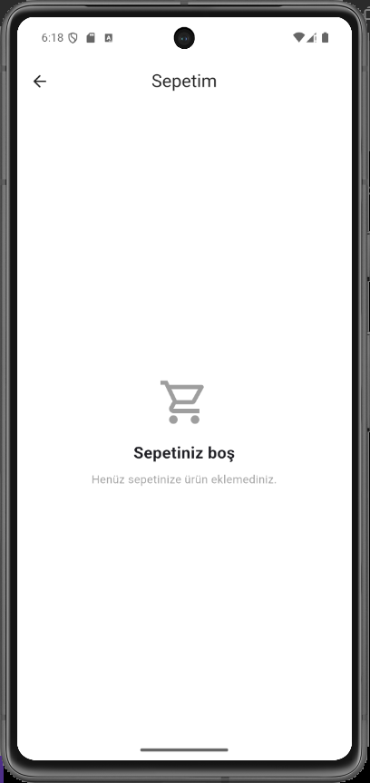

# Mini Katalog

Flutter ve Dart kullanılarak geliştirilmiş, API üzerinden ürünleri listeleyen ve temel sepet işlemlerini simüle eden mobil katalog uygulamasıdır.

Bu proje, **TNC Group Flutter eğitimi** kapsamında temel mobil uygulama geliştirme konularını uygulamalı olarak öğrenmek amacıyla hazırlanmıştır.

## Kullanılan Teknolojiler

- **Flutter:** 3.47.7
- **Dart:** 3.13.5
- **Arayüz:** Material Design
- **Veri Kaynağı:** WantAPI
- **Geliştirme Ortamı:** Visual Studio Code
- **Test Ortamı:** Android Emulator (Pixel 7)

## Uygulama Özellikleri

- WantAPI üzerinden ürün verilerini alma
- `GridView.builder` ile ürün listeleme
- Ürün adına göre arama ve filtreleme
- Ürün görsellerini, fiyatlarını ve açıklamalarını gösterme
- Ürün detayında teknik özellikleri görüntüleme
- `Navigator.push()` ve `Navigator.pop()` ile sayfalar arası geçiş
- Ürünleri sepete ekleme ve sepetten silme
- Sepet boş olduğunda bilgilendirme mesajı gösterme
- `setState()` ile temel durum yönetimi
- İnternet üzerinden banner ve ürün görsellerini yükleme

> **Not:** Sepet eğitim amaçlı bir simülasyondur. Veriler uygulama belleğinde tutulur. Veritabanı, ödeme sistemi veya kullanıcı hesabı bulunmamaktadır.

## Ekran Görüntüleri

### Ana Sayfa

Ürünlerin listelendiği, banner görselinin ve arama alanının bulunduğu ana ekran.



### Ürün Detay Sayfası

Seçilen ürünün görseli, fiyatı ve açıklamasının gösterildiği ekran.



### Sepet

Sepete eklenen ürünlerin listelendiği ve ürün silme işleminin yapılabildiği ekran.



### Boş Sepet

Sepette ürün bulunmadığında gösterilen bilgilendirme ekranı.



## Kullanılan API

Ürün verileri WantAPI üzerinden alınmaktadır.

**Ürün API adresi:**

https://wantapi.com/products.php

**Banner görseli:**

https://wantapi.com/assets/banner.png

API üzerinden ürünlerin adı, açıklaması, fiyatı, para birimi, görseli ve teknik özellikleri alınmaktadır.

Ürünlerin ve görsellerin yüklenmesi için internet bağlantısı gereklidir.

## Proje Klasör Yapısı

```text
mini_katalog/
├── assets/
│   └── data/
│       └── products.json
├── lib/
│   ├── main.dart
│   ├── app/
│   │   ├── app.dart
│   │   └── theme/
│   │       └── app_theme.dart
│   └── features/
│       ├── home/
│       │   └── pages/
│       │       └── home_page.dart
│       ├── products/
│       │   ├── data/
│       │   │   └── product_repository.dart
│       │   ├── models/
│       │   │   └── product.dart
│       │   ├── pages/
│       │   │   └── product_detail_page.dart
│       │   └── widgets/
│       │       └── product_card.dart
│       └── cart/
│           └── pages/
│               └── cart_page.dart
├── screenshots/
│   ├── 1.png
│   ├── 2.png
│   ├── 3.png
│   └── 4.png
├── test/
│   ├── product_test.dart
│   └── widget_test.dart
├── pubspec.yaml
└── README.md
```

## Kurulum ve Çalıştırma

### Gereksinimler

- Flutter SDK
- Dart SDK
- Android Studio ve Android Emulator veya fiziksel Android cihaz
- Visual Studio Code (isteğe bağlı)
- İnternet bağlantısı

### 1. Projeyi klonlayın

```bash
git clone https://github.com/onuraydinoglu/mini_katalog.git
```

### 2. Proje klasörüne girin

```bash
cd mini_katalog
```

### 3. Bağımlılıkları yükleyin

```bash
flutter pub get
```

### 4. Cihazları kontrol edin

```bash
flutter devices
```

### 5. Uygulamayı çalıştırın

```bash
flutter run
```

Belirli bir Android emülatöründe çalıştırmak için:

```bash
flutter run -d emulator-5554
```

## Test ve Kod Kontrolü

Kod analizi:

```bash
flutter analyze
```

Testleri çalıştırma:

```bash
flutter test
```

Kod biçimlendirme:

```bash
dart format lib test
```

## Eğitim Kapsamında Kullanılan Konular

- StatelessWidget ve StatefulWidget
- MaterialApp ve Scaffold
- Text, Container, Row ve Column
- Padding, Card ve ListTile
- GridView.builder ve ListView.builder
- Dart sınıfları ve koleksiyonları
- JSON veri işleme
- fromJson() ve toJson()
- Image.network
- Navigator ve MaterialPageRoute
- Sayfalar arasında veri aktarımı
- setState() ile durum güncelleme
- Ürün filtreleme

## Projenin Amacı

Mini Katalog, Flutter ile temel mobil uygulama geliştirme, API verilerini kullanma, ürün listeleme, sayfa navigasyonu ve basit durum yönetimi konularını uygulamalı olarak öğrenmek amacıyla geliştirilmiştir.

Proje, eğitim kapsamında hazırlanmış bir örnek uygulamadır.
